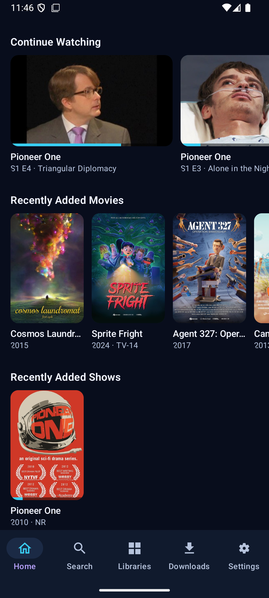
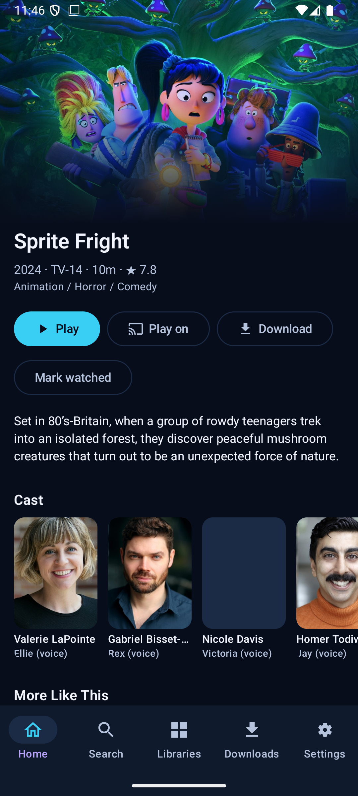
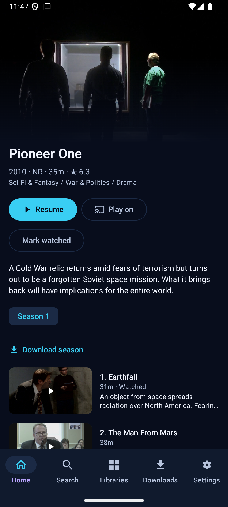
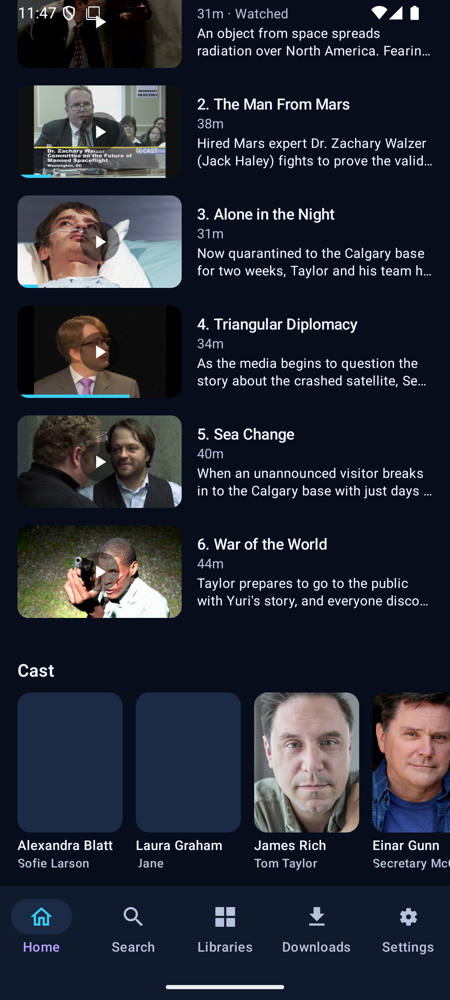
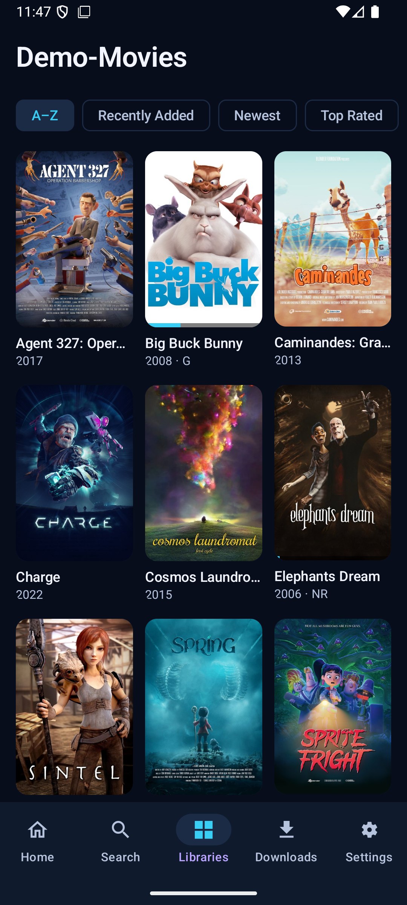
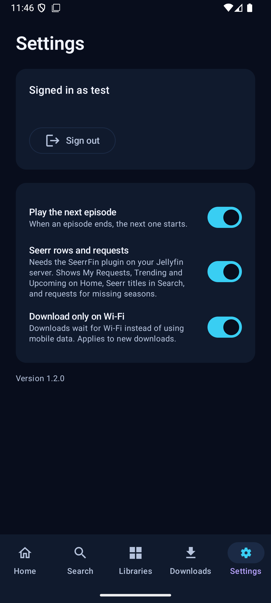

<h1 align="center">LumaFin for Android</h1>
<h3 align="center">A <a href="https://jellyfin.org">Jellyfin</a> client for Android phones, foldables and tablets</h3>

<strong>Download and install: <a href="https://getlumafin.com">getlumafin.com</a></strong>

LumaFin for Android brings the LumaFin experience to touch screens. Every screen follows the size of the
window, so it works on phones, folded and unfolded foldables, and tablets in either orientation.

- Home with Continue Watching, Next Up, Recently Added and Top Rated, plus Seerr requests
- Library browsing, title pages, cast pages and search
- Playback with picture-in-picture and a tabletop layout on half-open foldables
- Downloads for offline viewing, and Play on for Chromecast or another Jellyfin app on your account

## Screenshots

| Home | Movie | Show |
| --- | --- | --- |
|  |  |  |

| Episodes and cast | Library | Settings |
| --- | --- | --- |
|  |  |  |

Screenshots show Creative Commons films from Blender Studio ([studio.blender.org](https://studio.blender.org/films/)),
CC BY, and Pioneer One by Josh Bernhard and Bracey Smith, Creative Commons.

It is in alpha. Test builds are published as pre-releases on the
[releases page](https://github.com/bagodees/LumaFin-Android/releases).

The TV app (Android TV, Google TV and Fire TV) is
[LumaFin-AndroidTV](https://github.com/bagodees/LumaFin-AndroidTV).

This is not an officially supported Jellyfin project. See [LICENSE](LICENSE) for license details.
